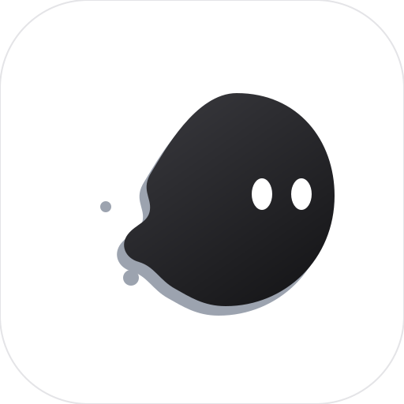
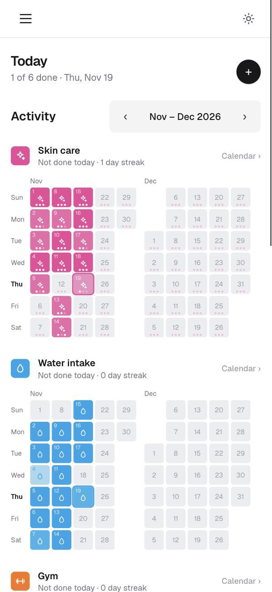
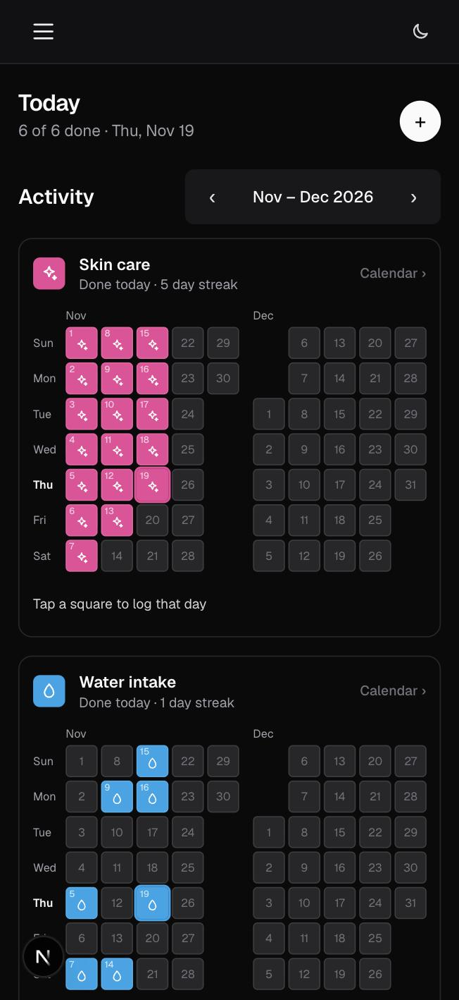

<div align="center">



# Habit Tracker

**Build routines you can see.** Log habits in a tap and watch them fill in as GitHub-style heatmaps.


<br />


&nbsp;&nbsp;&nbsp;


</div>

<br />

## Overview

Habit Tracker gives every habit its own colour, icon and heatmap. Skin care, water intake, gym, work, projects, reading, or anything you add yourself. Tap a square to log a day, and your streaks and history build up at a glance.

It is designed phone-first (touch-friendly, safe-area aware) and scales up to tablet and desktop. Your data stays in your browser: no account, no server.

## Features

- **Heatmap per habit.** Two months side by side, with every date numbered, weekday labels down the side and today highlighted with a coloured border. Logged days fill with the habit's icon, and counted habits (like water) deepen in colour as you approach the goal.
- **Month navigation.** Step forward or back through the months with the header arrows (up to 24 months back).
- **Calendar view.** Tap a habit's header to open a full month calendar, log or fix any day, and see how many days you completed and missed, with the dates listed. Missed days are marked with a red dot.
- **Your own habits.** The **+** button opens a form to add a habit: name, colour (24 to choose from), icon (36 to choose from), tracking mode and routine. Habits can be edited from their calendar, or edited and deleted from the Settings page.
- **Two tracking modes.** Simple *done / not done*, or a *count* toward a daily goal with a unit (for example 8 glasses).
- **Routines.** Schedule a habit for every day, weekdays, weekends or any custom set of days. Streaks only count the days it is scheduled.
- **Settings page.** Manage every habit in one place: edit it, or delete it (with a confirmation) along with its history.
- **Sidebar habit list.** All habits at a glance with today's status. Tapping one jumps to its heatmap.
- **Light, dark and auto themes.** A small toggle in the top bar cycles *Auto*, *Light* and *Dark*. Auto follows your device setting live, with no flash on load.
- **Responsive and touch-friendly.** Press feedback on squares, large tap targets, notch and home-bar safe areas, and a slide-in menu on phones.
- **Local-first.** Everything is saved to `localStorage`, and changes sync across open tabs.

## Getting started

**Prerequisites:** Node.js 20 or newer.

```bash
# install dependencies
npm install

# start the dev server
npm run dev
```

Then open [http://localhost:3000](http://localhost:3000).

| Script          | What it does                      |
| --------------- | --------------------------------- |
| `npm run dev`   | Start the development server      |
| `npm run build` | Create an optimised production build |
| `npm run start` | Serve the production build        |
| `npm run lint`  | Run ESLint                        |

## Tech stack

| Area      | Choice                                                                 |
| --------- | ---------------------------------------------------------------------- |
| Framework | [Next.js](https://nextjs.org) (App Router)                             |
| UI        | [React](https://react.dev) 19                                          |
| Styling   | [Tailwind CSS](https://tailwindcss.com) 4 with CSS-variable theming    |
| Language  | TypeScript                                                             |
| Storage   | Browser `localStorage`, read through `useSyncExternalStore`            |

## Project structure

```
src/
├── app/
│   ├── layout.tsx          # Root layout, viewport, theme boot script
│   ├── page.tsx            # Home: the habit tracker
│   ├── settings/page.tsx   # Settings: manage and delete habits
│   └── globals.css         # Theme tokens (light / dark)
├── components/
│   ├── HabitTracker.tsx    # Page shell: header, month navigation, habit list
│   ├── HabitHeatmap.tsx    # Per-habit heatmap card
│   ├── HabitCalendar.tsx   # Month calendar sheet
│   ├── HabitForm.tsx       # Add / edit habit sheet
│   ├── HabitIcon.tsx       # Icon set (inline SVG)
│   ├── SettingsHabits.tsx  # Habit management list for Settings
│   ├── Sidebar.tsx         # Top bar, menu drawer, habit list, Settings link
│   └── ThemeToggle.tsx     # Auto / Light / Dark switch
└── lib/
    ├── habits.ts           # Types, defaults, palette, streak and level logic
    ├── store.ts            # localStorage store shared across components
    └── theme.ts            # Theme preference helpers
```

## How your data is stored

Two keys are kept in the browser:

| Key                | Contents                                          |
| ------------------ | ------------------------------------------------- |
| `habits:list:v1`   | Your habits (name, colour, icon, goal, routine)   |
| `habits:v1`        | Logged counts, keyed by habit and `YYYY-MM-DD`    |

Clearing site data removes your history. There is currently no export or cross-device sync.

## Ideas for later

- Export and import your data
- Reminders for scheduled habits
- Optional account and sync across devices
- Weekly and monthly summaries

## Contributing

Habit Tracker is free and open source, and contributions are welcome. Found a bug or have an idea? Open an issue. Ready to help? Fork the repo, make your change on a branch, and open a pull request. Please run `npm run lint` before you submit.

## License

Released under the [MIT License](LICENSE). Free to use, change and share, for anyone.
